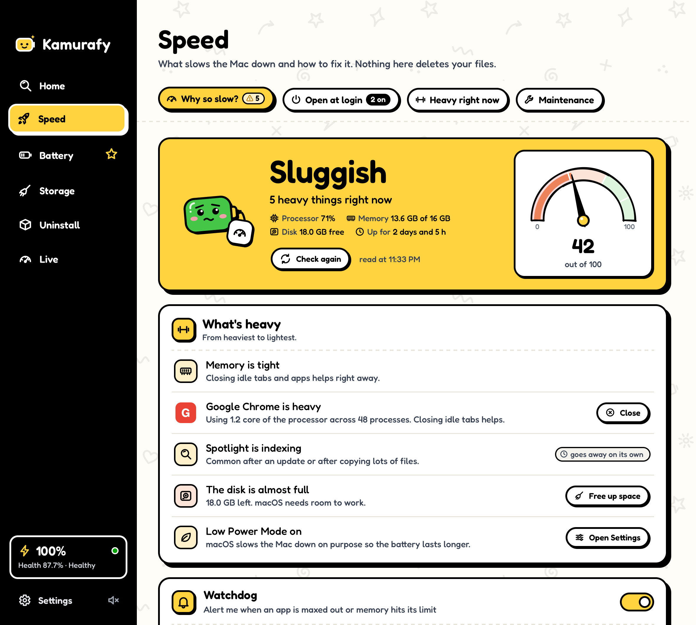
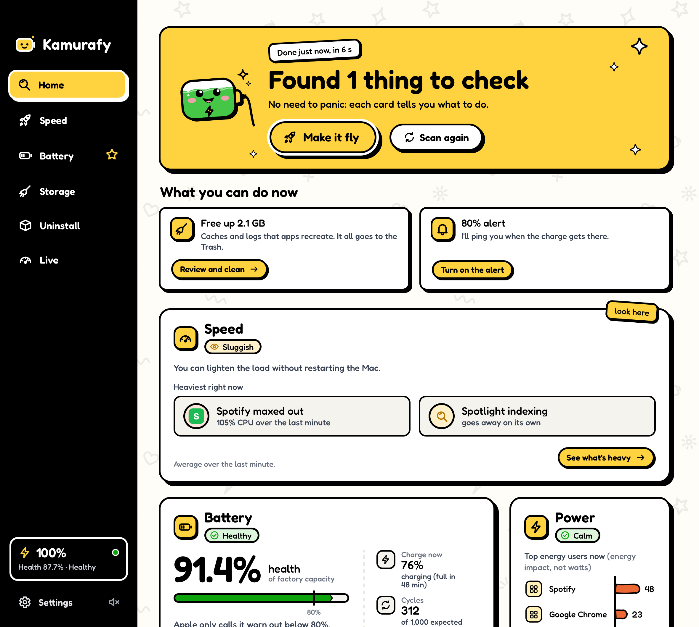
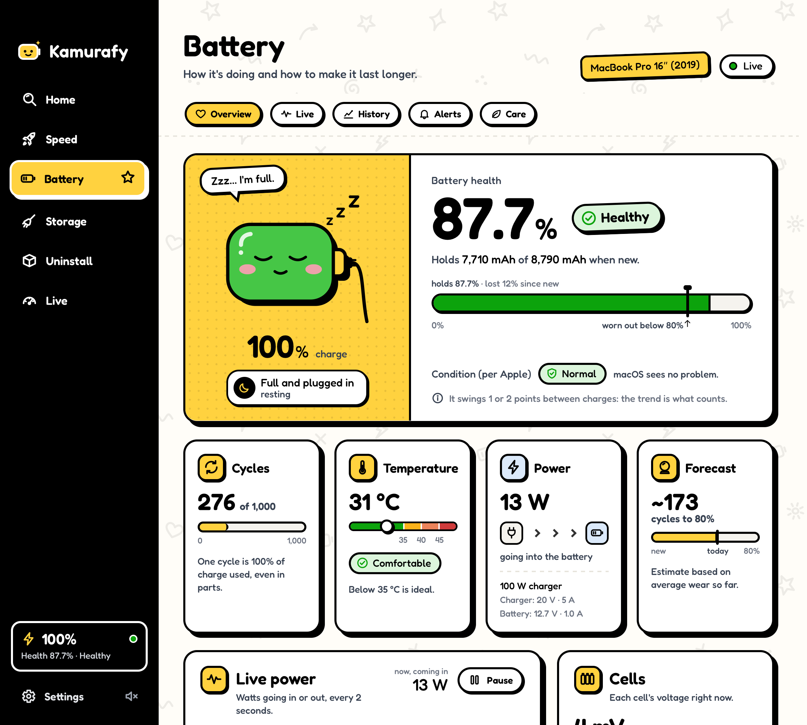
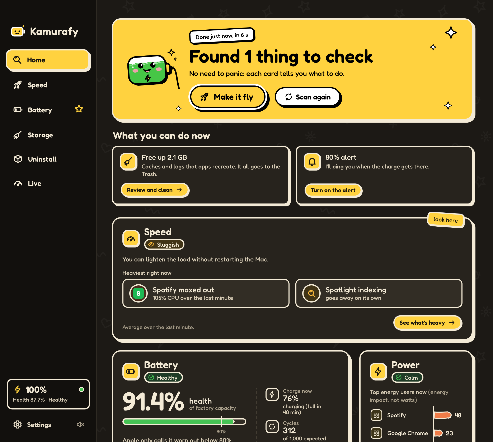

<p align="center">
  
</p>

<h1 align="center">Kamurafy</h1>

<p align="center">
  <b>The free, open-source CleanMyMac alternative that actually cares about your battery.</b><br>
  No subscription, no account, no ads, and nothing ever leaves your Mac.
</p>

<p align="center"><b>English</b> · <a href="README.pt-BR.md">Português</a></p>

<p align="center">
  <a href="../../releases/latest"><b>⬇️ Download Kamurafy</b></a> ·
  <a href="#what-it-does">What it does</a> ·
  <a href="#install">Install</a> ·
  <a href="#cleanup-safety">Safety</a> ·
  <a href="#build-from-source">Build</a>
</p>

<p align="center">
  
</p>

## What it does

**🚀 Speed: "Why is my Mac slow?"**
- One click tells you what is slowing your Mac down *right now*, from worst to least: memory pressure, an app maxed out on the CPU, a browser with too many tabs, Spotlight / Time Machine / iCloud / Photos working in the background, heat throttling the CPU, Low Power Mode, a nearly full disk, days without a restart, too many login items.
- Every item comes with the fix: quit the app, free up space, open the right System Settings pane. What the system will finish on its own is marked as such.
- No snake oil: no "free up RAM" button, no fake speed boost. Just what is really weighing on your Mac.

**✈️ Make it fly**: after a scan, one button does the safe fixes at once (caches to the Trash, the maxed-out apps you tick, the 80% charge alert), only after you review and confirm.

**👀 Watchdog**: warns you when an app stays maxed out for 10 minutes or memory hits the limit, even with the window closed. It never nags about the app you are using (a game, a video export).

**🔋 Battery (the star)**
- Real health: how much of its factory capacity it still holds, measured the way macOS does, and what that means.
- Cycles, temperature, per-cell voltage, watts in and out, the charger plugged in.
- The last 7 days of charge (from macOS's own log) and health day by day.
- An honest forecast of when it will reach 80%, showing how the math works.
- Who is draining it right now, with helpers and tabs added up under the right app.
- An alert when the charge reaches the limit you pick (say, 80%) and when the battery gets hot.

**🧹 Storage**: app caches, developer caches (npm, pip, Xcode, Gradle, Cargo…), logs, forgotten downloads, large files and duplicates. Everything goes to the Trash, with undo.

**📦 Uninstall**: removes an app together with the leftovers it scatters around your home folder.

**📊 Live**: CPU, memory (and why "freeing RAM" does not help), disk and your Mac, live. Plus a menu bar battery with a one-click summary.

**🪶 Lightweight**: idle with the window open it uses about 180 MB and next to no CPU. The current number is in Settings.

**🌙 Dark mode and three languages**: follows your macOS appearance (or the one you pick) and speaks English, Portuguese and Spanish.

<table>
  <tr>
    <td width="50%"></td>
    <td width="50%"></td>
  </tr>
  <tr>
    <td></td>
    <td></td>
  </tr>
</table>

## Install

1. Download `Kamurafy.dmg` from the [latest release](../../releases/latest) and drag Kamurafy to Applications.
2. Kamurafy is not signed with a paid Apple developer account yet, so macOS asks you to confirm the first time:
   - **macOS 15 or newer:** open it, close the warning, go to **System Settings › Privacy & Security** and click **Open Anyway**.
   - **macOS 13 and 14:** right-click the app › **Open** › **Open**.

Requires macOS 13 (Ventura) or newer. Universal: Intel and Apple Silicon.

Or with Homebrew:

```bash
brew install --cask gabrielkamura/tap/kamurafy
```

## Cleanup safety

Cleaning was designed to never delete what it should not:

- **You see everything first.** Nothing goes without you reviewing the list and confirming.
- **Everything goes to the Trash.** One click to undo. Deleting for good only happens when you ask, with a confirmation that says there is no way back.
- **Only known folders** in your home folder. Nothing from the system, no admin password, no following links out.
- **Double check.** Right before moving, the app checks again that the file is the same one it scanned and still in an allowed place.
- **Personal files are never pre-selected** (downloads, large files, duplicates). For duplicates, one copy always stays.
- **An open app does not get its cache cleaned.** Kamurafy asks you to quit it first.

Every change runs in CI against a fake home folder full of traps, and the build fails if anything outside it changes.

## Privacy

No account, no ads, no telemetry. Everything it reads (battery, history, files) stays on your Mac, in `~/Library/Application Support/Kamurafy`. The only time it talks to the internet is the optional new-version alert (off by default): once a day it asks GitHub for the latest release number, and nothing else.

## Build from source

No Xcode needed, just Apple's command line tools (`xcode-select --install`).

```bash
git clone https://github.com/GabrielKamura/kamurafy.git
cd kamurafy
./build.sh                 # builds build/Kamurafy.app (Intel + Apple Silicon)
open build/Kamurafy.app
```

- `ARCHS=x86_64 ./build.sh` builds for one architecture only (faster).
- `PUBLICO=1 ./build.sh` builds the distribution version (no test hooks).
- `ASSINATURA="Developer ID Application: …" PUBLICO=1 ./build.sh` signs with the hardened runtime, ready to notarize.

The shell is Swift (AppKit + WKWebView) and the interface is plain HTML, CSS and JavaScript in `ui/`. The bridge between them is documented in [`docs/ponte.md`](docs/ponte.md) and the look in [`docs/design.md`](docs/design.md) (both in Portuguese). Translations live in `ui/i18n/` (the Portuguese text in the code is the key): fixes and new languages are welcome.

## License

[GPL-3.0](LICENSE): you can use, study, change and share it, as long as what you share is open source under the same license.

Includes the [Fredoka](https://github.com/hafontia/Fredoka-One) font (SIL Open Font License 1.1) and [Rough.js](https://roughjs.com) (MIT). Mac and macOS are trademarks of Apple Inc.; Kamurafy is not affiliated with Apple or with MacPaw (CleanMyMac).

---

<p align="center">Made with care by Gabriel Kamura.</p>
