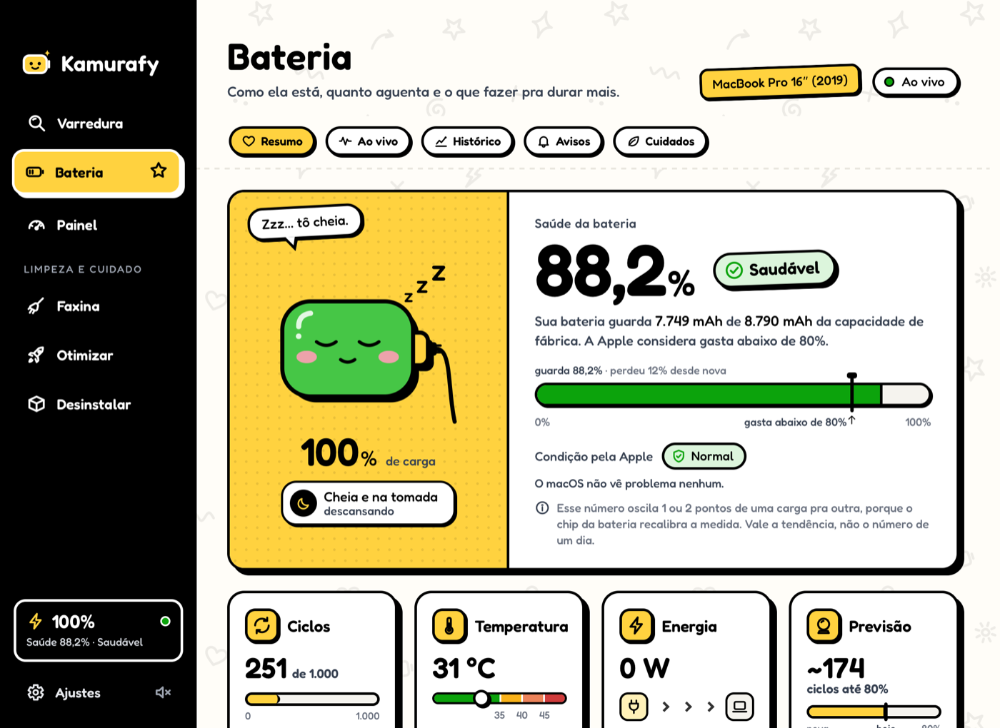

<p align="center">
  
</p>

<h1 align="center">Kamurafy</h1>

<p align="center">
  <b>Cuida do seu Mac e, principalmente, da sua bateria.</b><br>
  Grátis, de código aberto, sem assinatura e sem mandar nada pra internet.
</p>

<p align="center">
  <a href="../../releases/latest"><b>⬇️ Baixar o Kamurafy</b></a> ·
  <a href="#o-que-ele-faz">O que ele faz</a> ·
  <a href="#instalar">Instalar</a> ·
  <a href="#segurança-da-faxina">Segurança</a> ·
  <a href="#compilar">Compilar</a>
</p>

<p align="center">
  
</p>

## O que ele faz

**🔋 Bateria (a estrela)**
- Saúde de verdade: quanto da capacidade de fábrica ela ainda guarda, do jeito que o macOS mede, e o que isso quer dizer.
- Ciclos, temperatura, tensão de cada célula, watts entrando e saindo, carregador ligado.
- Os últimos 7 dias de carga (lidos do próprio registro do macOS) e a saúde dia a dia.
- Previsão honesta de quando ela chega a 80%, explicando como a conta é feita.
- Quem mais gasta bateria agora, com as abas e ajudantes somados no app certo.
- Aviso quando a carga chega no limite que você escolher (ex.: 80%) e quando a bateria esquenta.

**🔍 Varredura**: um botão confere bateria, energia, memória, processador, disco e sujeira, e diz o que dá pra fazer agora.

**📊 Painel**: processador, memória (com a explicação de por que "liberar RAM" não ajuda), disco e o seu Mac, ao vivo.

**🧹 Faxina**: caches de apps, caches de programação (npm, pip, Xcode…), logs, downloads esquecidos, arquivos grandes e duplicados. Tudo vai pra Lixeira, com desfazer.

**🚀 Otimizar**: o que abre sozinho quando o Mac liga, o que está pesando agora e tarefas de manutenção (DNS, Spotlight, "Abrir com").

**📦 Desinstalar**: tira o app junto com as sobras que ele espalha pela sua pasta.

**Na barra de menus**: a bateria sempre à vista, com um resumo a um clique.

## Instalar

1. Baixe o `Kamurafy.dmg` na [última versão](../../releases/latest) e arraste o Kamurafy pra pasta Aplicativos.
2. Na primeira vez, abra com o **botão direito › Abrir › Abrir**. O Kamurafy ainda não é assinado com uma conta de desenvolvedor da Apple, então o macOS pede essa confirmação uma vez. No macOS 15 ou mais novo: abra, feche o aviso, vá em **Ajustes do Sistema › Privacidade e Segurança** e clique em **Abrir Mesmo Assim**.

Precisa do macOS 13 (Ventura) ou mais novo. Funciona em Mac Intel e Apple Silicon.

## Segurança da Faxina

A Faxina foi feita pra nunca apagar o que não devia:

- **Você vê tudo antes.** Nada sai sem você ver a lista e confirmar.
- **Tudo vai pra Lixeira.** Dá pra desfazer com um clique. Apagar de vez só acontece se você mandar, com uma confirmação que avisa que não tem volta.
- **Só pastas conhecidas** da sua pasta de usuário. Nada do sistema, sem senha de administrador, sem seguir atalhos pra fora.
- **Conferência dupla.** Antes de mover, o app confere de novo se o arquivo é o mesmo da varredura e se continua no lugar permitido.
- **Arquivos pessoais nunca vêm marcados** (downloads, arquivos grandes, duplicados). Nos duplicados, sempre sobra uma cópia.
- **App aberto não tem o cache limpo.** O Kamurafy pede pra fechar antes.

## Privacidade

O Kamurafy não tem conta, não tem anúncio e não manda nada pra internet. Tudo o que ele lê (bateria, histórico, arquivos) fica no seu Mac, em `~/Library/Application Support/Kamurafy`.

## Compilar

Não precisa de Xcode: bastam as ferramentas de linha de comando da Apple (`xcode-select --install`).

```bash
git clone <este repositório>
cd kamurafy
./build.sh                 # gera build/Kamurafy.app (Intel + Apple Silicon)
open build/Kamurafy.app
```

- `ARCHS=x86_64 ./build.sh` compila só pra uma arquitetura (mais rápido).
- `PUBLICO=1 ./build.sh` gera a versão de distribuição (sem os ganchos de teste).
- `ASSINATURA="Developer ID Application: …" PUBLICO=1 ./build.sh` assina com hardened runtime, pronto pra notarizar.

A casca é Swift (AppKit + WKWebView) e a interface é HTML, CSS e JavaScript puros em `ui/`. O contrato entre as duas partes está em [`docs/ponte.md`](docs/ponte.md) e o visual em [`docs/design.md`](docs/design.md).

## Licença

[GPL-3.0](LICENSE): você pode usar, estudar, mudar e distribuir, desde que o que você distribuir também tenha o código aberto sob a mesma licença.

Inclui a fonte [Fredoka](https://github.com/hafontia/Fredoka-One) (SIL Open Font License 1.1) e a biblioteca [Rough.js](https://roughjs.com) (MIT).

---

<p align="center">Feito com carinho por Gabriel Kamura.</p>
